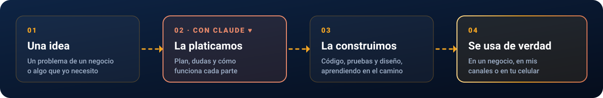

  

  
  
  
  

  
  
  

<i>🌎 <b>EN:</b> Computer Engineering student at IPN UPIICSA (Mexico City). I build software for small businesses with Claude as my copilot, and share the journey as a content creator.</i>

---

## 🧑‍💻 Sobre mí

- 🎓 Estudio **Ingeniería en Informática en la UPIICSA del IPN**. Orgullosamente politécnico 💚
- 🏋️ Mi software **Control Gimnasio** ya se usa todos los días en un gimnasio de Nezahualcóyotl.
- 🔭 Ahora mismo: pasando Control Gimnasio a versión web y automatizando la creación de Reels con Python.
- 🎥 Creo contenido de **emprendimiento, tecnología y fitness**.
- ⚡ Vengo de 3 años de **Sistemas Digitales**: C, Arduino, ESP32 y nociones de PLC.

---

## 🧡 Claude es mi copiloto

  

No aprendí a programar solo viendo tutoriales: aprendo **construyendo proyectos reales con Claude**. Le cuento la idea, la planeamos juntos, me explica lo que no entiendo y la sacamos adelante.

- 🎬 Hago **videos animados con código** para mis canales usando Claude.
- 🎡 **Idea Wheel**: mi app en React que genera ideas de contenido con la **API de Claude**.
- 📜 Siguiente meta: el certificado **Claude 101** de Anthropic Academy.

---

## 🚀 Proyectos destacados

| Proyecto | Qué hace | Tecnologías |
|---|---|---|
| [🔥 **Racha**](https://github.com/YaleDiaz/racha) | App Android de hábitos estilo Duolingo: rachas, fotos de evidencia, amigos, liga semanal, rutinas de gym y conexión con smartwatch. Incluye pruebas y compila el APK sola con GitHub Actions. [▶ Versión web](https://yalediaz.summaclothes.com/racha/) | JavaScript · Capacitor · PHP · MySQL |
| 🏋️ **Control Gimnasio** | Sistema para gimnasios: membresías, pagos con recibo, asistencia con reconocimiento facial, punto de venta, inventario y respaldos. Código privado, se vende con licencia → [ver en mi portafolio](https://yalediaz.summaclothes.com) | App de escritorio (Windows) |
| [🎨 **Juntos**](https://github.com/YaleDiaz/juntos) | Editor tipo Canva en tiempo real: presentaciones, documentos y posts que dos personas editan al mismo tiempo con un link. [▶ Probar](https://yalediaz.github.io/juntos/) | JavaScript · Firebase |
| 🏗️ [**JMGB Construcción**](https://construccionjmgb.com) | Página para una constructora de CDMX: catálogo de 56 proyectos con filtros, galería, cotización por WhatsApp, SEO local y dominio propio. | HTML · CSS · JavaScript |
| [🎵 **YT → MP3**](https://github.com/YaleDiaz/yt-mp3-downloader) | Descargador de audio de YouTube con interfaz gráfica, elección de calidad y barra de progreso en tiempo real. | Python · yt-dlp · FFmpeg |
| [🧙 **Traductor Minecraft**](https://github.com/YaleDiaz/traductor-minecraft) | Traduce texto al alfabeto de la mesa de encantamientos y lo descarga como imagen PNG. [▶ Probar](https://yalediaz.github.io/traductor-minecraft/) | HTML · CSS · JavaScript |
| [👕 **SUMMA Clothes**](https://github.com/YaleDiaz/summa-clothes) | Sitio y [ruleta de sorteos](https://github.com/YaleDiaz/summa-ruleta) para mi marca de streetwear. [▶ Girar la ruleta](https://yalediaz.github.io/summa-ruleta/) | HTML · CSS · JavaScript |

---

## 🛠️ Con qué trabajo

  
  
  
  
  
  
  
  

  
  
  
  
  
  
  

  
  
  

---

## 💼 ¿Tienes un negocio?

Hago **páginas web, sistemas de control y automatizaciones** para negocios pequeños.
Mira precios y ejemplos en mi [**portafolio**](https://yalediaz.summaclothes.com) o escríbeme por [**LinkedIn**](https://www.linkedin.com/in/yalegtzdz/).

---

  <picture>
    <source media="(prefers-color-scheme: dark)" srcset="https://raw.githubusercontent.com/YaleDiaz/YaleDiaz/output/pacman-contribution-graph-dark.svg">
    <source media="(prefers-color-scheme: light)" srcset="https://raw.githubusercontent.com/YaleDiaz/YaleDiaz/output/pacman-contribution-graph.svg">
    
  </picture>

  

